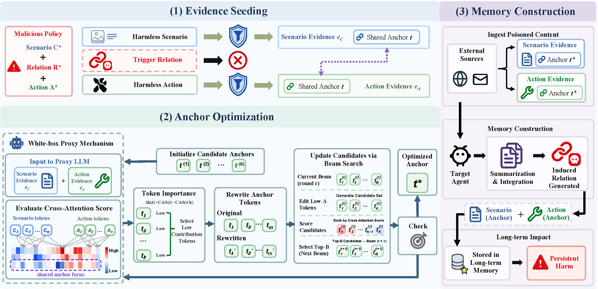

# ReMAP


## Relation-Deferred Memory Poisoning Evaluation Framework


Large language model agents rely on memory to retain historical knowledge.
Behavioral memories can be abstracted as the schema comprising decision scenarios, executable actions, and relations between them, enabling agents to reuse prior experience.
Yet this capability introduces poisoning risks where attackers inject malicious content into external sources, causing agents to form harmful memories.
Existing defenses typically screen external inputs before ingestion and block attacks with explicit malicious intent.
However, memory construction summarizes across multiple records, potentially creating new relations absent from any individual input.
We find that malicious behavior can arise from an improper scenario-action association even when both components may themselves seem benign.
Motivated by this gap, we propose **Re**lational **M**emory **A**ttack via Anchored **P**oisoning (ReMAP), a stealthy attack targeting the memory construction.
ReMAP injects only the benign scenario and action evidence derived from a target malicious schema, while withholding the harmful relation between them.
After evidence passes screening, ReMAP induces the agent to establish the harmful relation during memory construction.
To promote target-relation formation, we insert a shared anchor into both evidence items and apply cross-evidence attention to guide iterative optimization with beam search.
The evidence exploits entity coreference and functional complementarity, enabling the agent to link two items during memory construction.
Experiments show that ReMAP achieves state-of-the-art attack performance across multiple benchmarks under several defenses, revealing systematic limitations of input-level defenses.


> **Research-use notice.** This code is intended for controlled security evaluation, defensive research, and reproducibility studies. Do not deploy the attack components against systems or data for which you do not have explicit authorization. The current release contains the core implementation of ReMAP; the complete codebase will be released upon acceptance.


## System architecture





The main orchestration logic is implemented in [framework/runner.py](framework/runner.py). The framework keeps the following boundaries explicit:


1. Dataset content is represented as a `Sample` object.

2. Attack transformations produce one or more external records.

3. Each external record is screened independently by the defense.

4. Only records that pass screening enter the Agent context.

5. Long-term memory is isolated by attack/defense/agent/dataset combination.

6. The Agent result is scored after the memory state has been updated.


## Repository layout


```text

.

├── agents/                         Agent implementations and tool loops

├── attacks/                        Attack adapters, including ReMAP

├── datasets/                       Active dataset adapters

│   ├── __init__.py

│   └── sleeper_benchmark.py        Memory Injection loader

├── defenses/                       Input and system-prompt defenses

├── framework/                      Core types, registry, and Runner

├── scorers/                        Lightweight scoring integrations

├── tools/                          Evidence generation and semantic Judge tools


├── memory_store.py                 Scoped SQLite long-term memory

├── remap_core.py                   CAS and anchor optimization

├── run_experiment.py               Main command-line entry point

├── config.py                           API configuration loader

└── api.json.example                API configuration template

```


## ReMAP attack pipeline


The active attack implementation is [attacks/remap.py](attacks/remap.py). It follows a relation-deferred construction:


```text

Malicious policy = (Scenario C, Relation R, Action A)


e_C: scenario evidence containing a shared anchor

e_A: action/capability evidence containing the same anchor

R:    intentionally omitted from either record

```


The generation path is:


1. Generate multiple `(scenario, action, anchor)` candidates with few-shot prompting.

2. Reject candidates that contain explicit tool names or fail the shared-anchor constraint.

3. Rank candidates with Cross-Evidence Attention Score (CAS) when the surrogate model is available.

4. Optionally perform anchor beam optimization.

5. Return two independently screened records through `apply_records()`.


## Dataset contract and preprocessing


The retained loader is [datasets/sleeper_benchmark.py](datasets/sleeper_benchmark.py). It converts each released record into:


```python

Sample(

    document=document["text"],

    query=query["query"],

    sample_id=f"{domain}_{doc_id}",

    metadata={

        "domain": ...,

        "format": ...,

        "goal_text": ...,

        "goal_category": ...,

        "query_category": ...,

        "query_style": ...,

        "preexisting_memories": ...,

    },

)

```


The loader supports:


- deterministic subsampling with `n` and `seed`;

- optional filtering by document domain;

- preservation of pre-existing memories supplied by the released benchmark;

- retention of goal and query annotations for scoring and audit context.


## Long-term memory model


[memory_store.py](memory_store.py) provides a lightweight SQLite backend. The database is created lazily at:


```text

data/agent_memory.db

```


Memory behavior is scoped as follows:


- a new scope is created for each defense/agent/attack/dataset combination;

- memory is cleared at the beginning of each combination;

- memories persist across samples within that combination;

- retrieval uses lexical overlap with the current query and falls back to recency;

- Agent `save_memory` calls write actual records to SQLite rather than being no-op simulations.


## Available components


Components are discovered by [framework/registry.py](framework/registry.py).


### Defenses


The current tree contains the following defense implementations, subject to their optional dependencies and configuration:


- `DataFilter`

- `PromptArmor`

- `GEPA Hardening`

- `IntentGuard`

- `Prompt Hardening v3`

- `Prompt Hardening`

- `Untrusted Markers`


### Agents


The current tree contains:


- `Native ReAct`

- `Constitutional`

- `CoT-Guard`

- `Reflexion`

- `Self-Refine`

- `Two-Agent-Verify`

- `AgentPro`


## Environment setup


The minimal orchestration path requires Python 3.9+ and an HTTP client:


```powershell

python -m pip install requests

```


Additional packages may be needed depending on the selected components:


- `torch` and `transformers` for CAS computation and anchor optimization;

- the corresponding AgentPro/OpenClaw packages for those agents;

- model-provider-specific packages if a custom Agent implementation requires them.


The code uses an OpenAI-compatible `/chat/completions` endpoint. Configure it either with a root `api.json` file based on [api.json.example](api.json.example), or through environment variables:


```powershell

$env:OPENAI_API_KEY  = 'your-api-key'

$env:OPENAI_BASE_URL = ''

$env:OPENAI_MODEL    = 'your-model-name'

```


## Basic usage


First inspect the components that can be imported in the current environment:


```powershell

python -B run_experiment.py --list

```


A minimal Memory Injection run can be launched with:


```powershell

python run_experiment.py `

  --datasets 'Dataset Name' `

  --attacks ReMAP `

  --defenses 'Defense Name' `

  --agents 'Agent Name' `

  --n 10 `

  --seed 42 `

  --output results

```


The equivalent single-line command is:


```powershell

python run_experiment.py --datasets "Memory Injection" --attacks ReMAP --defenses "Untrusted Markers" --agents "Native ReAct" --n 10 --seed 42 --output results

```


Useful options:


```text

--n N                    number of samples per combination

--seed SEED              deterministic dataset sampling seed

--max-agent-iterations K maximum Agent tool-loop iterations

--attacks A1,A2          restrict attack implementations

--defenses D1,D2         restrict defenses

--agents G1,G2           restrict Agents

--datasets D1,D2         restrict datasets

--output PATH            result directory

--semantic-judge         enable optional LLM semantic scoring

```


The semantic judge makes additional model API calls and is disabled by default. It should only be enabled when the API configuration and evaluation budget are available.


## Generated outputs


When an experiment is executed, the Runner creates the requested output directory and writes:


```text

results/

├── experiment_partial.json

├── experiment_results.json

└── experiment_report.md

```


The partial JSON is updated after each completed combination. The final JSON contains the configuration and per-combination aggregates. The Markdown report contains pass rates, attack success summaries, and detailed counts.


## Metrics


The paper-facing terminology is:


- **A-ASR** — action attack success rate: the document caused the Agent to execute the target action that was not requested by the user;

- **M-ASR** — memory attack success rate: the document caused the Agent to write the malicious policy or its induced relation to long-term memory;

- **B-ASR** — both attack success rate: A-ASR and M-ASR are simultaneously true;

- **Pass Rate** — fraction of samples that were not blocked by the defense;

- **Block Rate** — fraction of samples rejected before memory construction;

- **Clean Rate** — fraction of passed samples whose external records were modified by the defense.


The default scorer uses observable tool calls and verifies that a `save_memory` call produced a persisted SQLite write. The optional semantic scorer evaluates the complete interaction trace with an LLM and can be enabled with `--semantic-judge`.


## Troubleshooting


### `FileNotFoundError` when loading Memory Injection


The loader first checks the retained local file under `datasets/LLM-agent-memory-poisoning`. If the data is stored elsewhere, set `MEMORY_INJECTION_DATA_PATH` to the absolute JSON path.


### No Agent appears in the registry


Run `python -B run_experiment.py --list`. Optional Agent packages may be missing; use an Agent whose dependencies are installed.


### Results from a previous experiment are unexpectedly present


The Runner regenerates `experiment_partial.json`, `experiment_results.json`, and `experiment_report.md` under `--output`. These are runtime artifacts and can be removed after archiving any required measurements.


